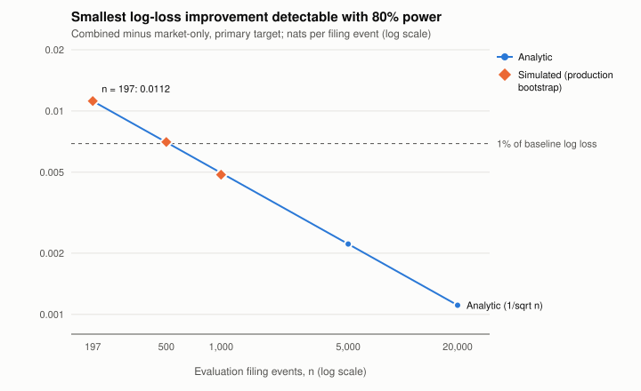

# Power / minimum-detectable-effect study: filing-text comparison

**Summary (for the hub findings table).** The published 2025 comparison (primary target, n = 197
filing events, block-bootstrap 95% interval [-0.0049, +0.0108] on combined-minus-market log loss)
had 80% power at 5% size only for log-loss improvements of at least **0.0112 nats per event**.
That is **1.6% of the majority-baseline log loss** (0.6911). In plainer terms, it is roughly what a
calibrated forecast with about ±7.4 percentage points of RMS spread around 50%, and an AUC near
0.58, would deliver. A Monte Carlo through the study's own bootstrap code gives the same MDE
(0.0112, ratio 1.001). The design could have detected an improvement of that size, and it did not
detect one. Smaller improvements are not excluded by the design. The realized interval does
exclude improvements larger than about 0.005 nats (about 0.7% of baseline) at the nominal 95%
level. The comparison model had no skill either: the market-only model's 2025 log loss equals the
majority baseline's to 0.00002 nats, and its AUC of 0.510 is 0.25 null SEs above 0.5. Detecting a
1% improvement in log loss would take about 515 events under the same design; 0.5% would take
about 2,060. Side finding: the published percentile block bootstrap (19 blocks) rejects a true
null about 7.8% of the time instead of 5%.

Frozen design: [`PROTOCOL.md`](PROTOCOL.md) (commit `dd2af5156f3415ad4b640381fbc2c49dd0104660`,
pushed 2026-10-20T06:48Z before the full run). Results: `results/power/sentiment_mde.json`.
Figure: `results/power/sentiment_mde_vs_n.svg`. No amendments.

## 1. Question

The authoritative historical study found that adding Loughran-McDonald filing-text features to a
market-only logistic model did not lower out-of-sample log loss in 2025. For the primary target
the delta was +0.0041 (combined worse), and the 500-resample block-bootstrap (block size 10)
interval was [-0.0048506, +0.0108001], n = 197. This study does not re-evaluate that result. It
asks two questions. How large an improvement could that design have detected? And did the
comparison model itself have skill?

## 2. Design (summary; full detail in PROTOCOL.md)

- **Inputs.** The six committed v2 result JSONs. Each is sha256-verified against
  `research/experiment-ledger.csv`. Also `publication/sentiment-study/tables/period-metrics.csv`.
  No per-observation predictions or losses are committed, and the corpora are not in the repo.
  The preferred resampling-from-real-losses method was therefore not available.
- **Headline (analytic).** SE_hat = interval width / 3.92. MDE80 = (1.96 + 0.84) × SE_hat.
- **Check (simulation, rule 3).** Synthetic per-row loss differences with planted mean shifts,
  run through the production `quant_sentiment.historical_text_study_v2._block_bootstrap_delta_ci`
  (500 resamples, block size 10). "Detected" means the 95% interval lies entirely below zero. The
  noise scale is calibrated so the true SE of the mean at n = 197 equals SE_hat. Cells: iid
  Gaussian (base) at n ∈ {197, 500, 1000}; AR(1) ρ = 0.3 and 0.6, and iid Student-t(4), at
  n = 197. R = 2000 replications at n = 197, R = 1000 otherwise. Master seed 20261020.
- **Projection.** SE(n) = SE_hat × sqrt(197 / n), n ∈ {197, 500, 1000, 5000, 20000}.
- **Baseline skill.** Market-only vs majority class from the committed tables, plus a
  Hanley-McNeil null SE for the market-only AUC.

## 3. Results

### 3.1 Headline MDE at the published n = 197 (primary, 2025)

| Quantity | Value |
|---|---|
| SE_hat (from committed interval) | 0.0039925 |
| **Analytic MDE80** | **0.011179 nats** |
| As share of majority-baseline log loss (0.6911031) | **1.62%** |
| Simulated MDE80, base cell (production bootstrap, R = 2000) | 0.011195 (ratio 1.001; rule 2: confirmed) |
| Power at the analytic MDE (k = 2.8 SE), base cell | 0.799 |
| Illustrative: calibrated-forecast RMS spread for that gain | ±0.074 around 0.5 |
| Illustrative: AUC of that calibrated forecast | 0.584 |

### 3.2 Simulated power curves (share of replications with interval entirely below zero)

Planted improvement in SE units (k); SE = true SE of the mean at that n.

| Cell | n | R | k=0 | 1.0 | 2.0 | 2.5 | 2.8 | 3.0 | 4.0 | MDE80 (SE) | MDE80 (nats) | Size at k=0 (two-sided) | Bootstrap SE / true SE |
|---|---|---|---|---|---|---|---|---|---|---|---|---|---|
| Gaussian iid | 197 | 2000 | 0.034 | 0.191 | 0.533 | 0.709 | 0.799 | 0.849 | 0.971 | 2.80 | 0.01119 | **0.078** | 0.977 |
| Gaussian iid | 500 | 1000 | 0.031 | 0.179 | 0.513 | 0.708 | 0.798 | 0.838 | 0.980 | 2.81 | 0.00704 | 0.064 | 0.981 |
| Gaussian iid | 1000 | 1000 | 0.030 | 0.187 | 0.550 | 0.716 | 0.820 | 0.877 | 0.986 | 2.74 | 0.00486 | 0.057 | 0.988 |
| AR(1) ρ=0.3 | 197 | 2000 | 0.044 | 0.221 | 0.578 | 0.732 | 0.808 | 0.850 | 0.976 | 2.77 | 0.01105 | 0.092 | 0.937 |
| AR(1) ρ=0.6 | 197 | 2000 | 0.058 | 0.261 | 0.609 | 0.773 | 0.845 | 0.887 | 0.984 | 2.61 | 0.01043 | 0.112 | 0.871 |
| Student-t(4) | 197 | 2000 | 0.033 | 0.216 | 0.556 | 0.728 | 0.808 | 0.852 | 0.970 | 2.77 | 0.01106 | 0.073 | 0.966 |

Monte Carlo SE of a power near 0.8 is about 0.009 at R = 2000 and 0.013 at R = 1000. The full grid
(including k = 0.5, 1.5, 3.5) is in the JSON.

**Rule 3 finding (size).** In the base cell, the published decision rule ("95% interval excludes
zero") rejects a true null 7.8% of the time: 3.4% on the improvement side and 4.4% on the harm
side, against a nominal 2.5% each. That is above the pre-set 7.5% flag, so the percentile
moving-block bootstrap is **anti-conservative at n = 197**. The cause is that it uses only
n // 10 = 19 blocks, and its implied SE averages 2.3% below the true SE. The excess shrinks with n
(6.4% at 500, 5.7% at 1000). It grows when dependence is longer than the block allows (9.2% at
ρ = 0.3, 11.2% at ρ = 0.6). This does not weaken the published null. An anti-conservative test
rejects more readily than nominal, and it still did not reject. It does mean the realized interval
is somewhat too narrow (see 4b). This is reported as a finding only; production code is unchanged.

### 3.3 Projection of the MDE over n (analytic, SE ∝ 1/sqrt(n))

| n | SE | MDE80 (nats) | Share of baseline log loss | Simulated check |
|---|---|---|---|---|
| 197 (published) | 0.003993 | 0.01118 | 1.62% | 0.01119 |
| 500 | 0.002506 | 0.00702 | 1.02% | 0.00704 |
| 1,000 | 0.001772 | 0.00496 | 0.72% | 0.00486 |
| 5,000 | 0.000792 | 0.00222 | 0.32% | analytic only |
| 20,000 | 0.000396 | 0.00111 | 0.16% | analytic only |

n needed for MDE80 = 1% of baseline log loss (0.00691 nats): **about 515**. For 0.5% (0.00346
nats): **about 2,062**.



### 3.4 MDE implied by every committed interval (secondary)

| Block | Target | n | Interval | SE_hat | SE_hat × √n | MDE80 | Share of baseline |
|---|---|---|---|---|---|---|---|
| development internal test | primary | 20 | [+0.00546, +0.03545] | 0.00765 | 0.034 | 0.0214 | 3.0% |
| development internal test | secondary | 20 | [+0.01066, +0.05154] | 0.01043 | 0.047 | 0.0292 | 4.2% |
| 2024 validation | primary | 210 | [-0.00280, +0.01163] | 0.00368 | 0.053 | 0.0103 | 1.5% |
| 2024 validation | secondary | 210 | [-0.00306, +0.01037] | 0.00343 | 0.050 | 0.0096 | 1.4% |
| **2025 evaluation** | **primary** | **197** | **[-0.00485, +0.01080]** | **0.00399** | **0.056** | **0.0112** | **1.6%** |
| 2025 evaluation | secondary | 197 | [-0.00472, +0.01184] | 0.00422 | 0.059 | 0.0118 | 1.7% |

For the three blocks with n ≈ 200, the per-row scale SE_hat × √n falls between 0.050 and 0.059.
That loosely supports using one variance scale for the projection.

### 3.5 Baseline skill: did the comparison model have skill?

Market-only (model 1) minus majority baseline (model 0), from `tables/period-metrics.csv`.
Negative log-loss and Brier differences favour market-only. AUC null SE is Hanley-McNeil
(independent rows).

| Block | Target | n | Δ log loss | Δ Brier | Balanced acc. | AUC | AUC z | AUC MDE80 | Rule 5 |
|---|---|---|---|---|---|---|---|---|---|
| dev internal test | primary | 20 | -0.02119 | -0.01020 | 0.615 | 0.692 | 1.39 | 0.888 | no demonstrable skill |
| dev internal test | secondary | 20 | -0.01228 | -0.00602 | 0.458 | 0.490 | -0.08 | 0.878 | no demonstrable skill |
| 2024 validation | primary | 210 | +0.00241 | +0.00120 | 0.517 | 0.508 | 0.20 | 0.612 | no demonstrable skill |
| 2024 validation | secondary | 210 | +0.00266 | +0.00136 | 0.472 | 0.482 | -0.45 | 0.612 | no demonstrable skill |
| **2025 evaluation** | **primary** | **197** | **-0.000024** | **-0.000019** | **0.503** | **0.510** | **0.25** | **0.616** | **no demonstrable skill** |
| 2025 evaluation | secondary | 197 | -0.00928 | -0.00460 | 0.541 | 0.573 | 1.78 | 0.616 | no demonstrable skill (closest to the line) |

For the headline cell, the market-only model is indistinguishable from predicting the base rate.
Its log loss is lower by 0.000024 nats, about 0.2% of the MDE. The combined-minus-market
comparison is therefore, in effect, a test of whether text features give skill from a standing
start. It is not a test of whether text adds to a working market model. The 2025 secondary target
is the only cell where the market-only model comes near detectability (AUC 0.573, z = 1.78), and
it does not cross the pre-set line.

## 4. Interpretation: what the published null does and does not rule out

a. **Design power.** At n = 197 the study had about an 80% chance of detecting a true log-loss
   improvement of 0.0112 nats (1.6% of baseline) or more. Improvements smaller than that, such as
   improvements of 0.5% to 1% of baseline log loss, would usually have gone undetected. "Failure to demonstrate" therefore does not mean "filing text carries no
   information".

b. **What this sample excludes.** Separately from design power, the realized interval's lower end
   is -0.0049. Taken at face value, this sample is inconsistent (at the nominal 95% level) with
   the combined model improving log loss by more than about 0.005 nats (0.7% of baseline). The
   size finding above implies the published interval is a little too narrow, so this exclusion is
   somewhat weaker than nominal. No equivalence or "no effect" claim is made.

c. **What it does not rule out.** Improvements between zero and about 0.005 nats are compatible
   with the data. The design had low power below about 0.011 nats. The comparison baseline itself
   had no skill, so the study says nothing about text adding to a model that already forecasts
   well.

d. The published 2025 conclusion is unchanged. This calibration only states how much weight it can
   carry.

## 5. Limitations

- **No per-observation losses are committed.** The headline is analytic from one bootstrap
  interval (500 resamples, 19 blocks). That interval is itself noisy and somewhat asymmetric
  (lower arm 0.0089, upper arm 0.0067 about the mean). The MDE inherits that uncertainty, plausibly
  ±10–20%.
- **The simulation is synthetic.** It checks the mapping from interval to MDE and the behaviour of
  the production decision rule under stated noise models (Gaussian iid or AR(1), Student-t(4)). It
  does not reproduce the real loss distribution or the real cross-issuer and earnings-season
  dependence.
- **The projection assumes** constant per-row variance and short-range dependence. In practice,
  more n would come from more years or issuers, which changes heterogeneity, clustering and the
  fitted models. Dependence longer than the 10-row block would make the MDE shrink more slowly
  than 1/sqrt(n).
- **The AUC null SE assumes independent rows.** The calibrated-forecast translation assumes a base
  rate of 0.5 and a Gaussian spread. Both are illustrative.
- The 2025 window was previously inspected (see `research/holdout-audit.md`). That affects how the
  point estimate should be read, not the power calculation.

## 6. Reproduction

Python 3.12, from the repository root:

```bash
python -m pip install -r requirements-lock.txt && python -m pip install -e . --no-deps
python research/power/sentiment_mde.py \
  --out-json results/power/sentiment_mde.json \
  --out-svg results/power/sentiment_mde_vs_n.svg
```

The full run takes about 22 minutes on one CPU (1,293 s measured) and is deterministic. The smoke
version runs in the test suite (`tests/test_power_sentiment_mde.py`, a few seconds):
`python research/power/sentiment_mde.py --smoke --out-json /tmp/smoke.json`.
